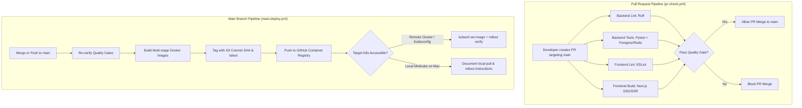

# CI/CD Pipeline Documentation

This document describes the continuous integration and continuous deployment (CI/CD) architecture for the **Generative AI-Based University Knowledge Assistant** project.

---

## 1. Pipeline Architecture

The project employs **GitHub Actions** with portable shell scripts (`scripts/ci/` and `scripts/deploy/`) to ensure full migration readiness to **Jenkins** or any containerized runner.



---

## 2. Workflow Triggers

| Workflow File | Trigger Event | Target Branch | Paths / Scope | Purpose |
|---|---|---|---|---|
| `.github/workflows/pr-check.yml` | `pull_request` | `main` | `backend/**`, `frontend/**`, `docker/**`, `kubernetes/**`, `scripts/**`, `pyproject.toml` | Enforce code style, linting, unit/integration tests, and frontend build integrity before merge. |
| `.github/workflows/main-deploy.yml` | `push` | `main` | All files | Quality gate verification, multi-stage Docker builds, image publishing to GHCR, and deployment gating. |

---

## 3. GitHub Secrets & Permissions

### Minimum Required Permissions
Workflows adhere to the principle of least privilege:
- `pr-check.yml`: `contents: read`
- `main-deploy.yml`: `contents: read`, `packages: write` (for publishing to GHCR)

### Secrets Reference

| Secret Name | Required? | Source | Description |
|---|---|---|---|
| `GITHUB_TOKEN` | Automatically Provided | GitHub Actions | Used to authenticate Docker to `ghcr.io` for container image publishing. |
| `KUBECONFIG_DATA` | Optional | User Configured | Base64-encoded `kubeconfig` string used only if deploying to a remote cloud Kubernetes cluster (e.g. GKE, EKS, AKS). Not needed for local Minikube. |

> [!IMPORTANT]
> Never commit API keys, database credentials, or private kubeconfigs into source control. All database passwords and service tokens are injected via Kubernetes Secrets (`kubernetes/base/secrets.yaml`).

---

## 4. Container Registry (GHCR) Image Naming

Images are published to GitHub Container Registry under the repository owner namespace:

* **Backend Image:**
  `ghcr.io/<owner>/university-knowledge-assistant-backend:<git-commit-sha>`
  `ghcr.io/<owner>/university-knowledge-assistant-backend:latest`
* **Frontend Image:**
  `ghcr.io/<owner>/university-knowledge-assistant-frontend:<git-commit-sha>`
  `ghcr.io/<owner>/university-knowledge-assistant-frontend:latest`

Tagging every build with the full Git commit SHA (`git rev-parse HEAD`) guarantees immutable, traceable releases and allows instant rollbacks to any prior commit.

---

## 5. Local Minikube Deployment from Mac

GitHub-hosted cloud runners cannot directly reach a local Minikube instance running inside a local Mac virtual machine. Therefore, the cloud pipeline builds and publishes images to GHCR, and you can deploy them locally on your Mac using the deployment script:

```bash
# 1. Ensure Minikube is running on your Mac
minikube status

# 2. Deploy published image tag (or latest commit) to Minikube
./scripts/deploy/deploy-k8s.sh $(git rev-parse HEAD) ghcr.io/<your-github-username>

# 3. Alternatively, update images directly using kubectl
kubectl set image deployment/backend backend=ghcr.io/<your-github-username>/university-knowledge-assistant-backend:latest
kubectl set image deployment/frontend frontend=ghcr.io/<your-github-username>/university-knowledge-assistant-frontend:latest

# 4. Watch rollout status
kubectl rollout status deployment/backend --timeout=120s
kubectl rollout status deployment/frontend --timeout=120s
```

---

## 6. Remote Kubernetes Prerequisites

To enable automated zero-downtime deployment to a remote cluster directly from GitHub Actions:
1. Export your remote cluster `kubeconfig`:
   ```bash
   cat ~/.kube/config | base64
   ```
2. In your GitHub repository settings, navigate to **Settings** $\rightarrow$ **Secrets and variables** $\rightarrow$ **Actions**.
3. Create a new repository secret named `KUBECONFIG_DATA` and paste the base64 string.
4. When `KUBECONFIG_DATA` is present, `main-deploy.yml` automatically mounts the kubeconfig and triggers the rolling update via `scripts/deploy/deploy-k8s.sh`.

---

## 7. Rollback Procedures

If an issue is detected in a newly deployed revision:

### Fast Rollback Command
```bash
# Rollback backend deployment
./scripts/deploy/rollback-k8s.sh backend

# Or invoke kubectl directly:
kubectl rollout undo deployment/backend
```

### Inspect Rollout History
```bash
kubectl rollout history deployment/backend
```

### Verify Rollback Status
```bash
kubectl rollout status deployment/backend --timeout=120s
```

---

## 8. Future Jenkins Migration Guide

To ensure future portability without rewriting CI/CD logic, all operational commands are contained in modular POSIX shell scripts:

```
scripts/
├── ci/
│   ├── lint-backend.sh    # Runs Ruff check backend/
│   ├── test-backend.sh    # Runs pytest backend/tests with PYTHONPATH=.
│   ├── lint-frontend.sh   # Runs npm run lint in frontend/
│   ├── build-frontend.sh  # Runs npm run build in frontend/
│   ├── build-docker.sh    # Multi-stage docker build for backend/frontend
│   └── push-docker.sh     # Pushes tagged images to registry
└── deploy/
    ├── deploy-k8s.sh      # Cluster connectivity check + rolling update
    └── rollback-k8s.sh    # Automated rollback via kubectl rollout undo
```

When migrating to **Jenkins**:
1. Simply install Python 3.12, Node.js 20, Docker, and kubectl on the Jenkins agent.
2. In your Jenkins Pipeline stages (`sh`), call the exact same scripts:
   - `sh './scripts/ci/lint-backend.sh'`
   - `sh './scripts/ci/test-backend.sh'`
   - `sh './scripts/ci/lint-frontend.sh'`
   - `sh './scripts/ci/build-docker.sh backend ${GIT_COMMIT} ${REGISTRY}'`
   - `sh './scripts/deploy/deploy-k8s.sh ${GIT_COMMIT} ${REGISTRY}'`
3. Zero migration changes are required to application code or deployment scripts.
