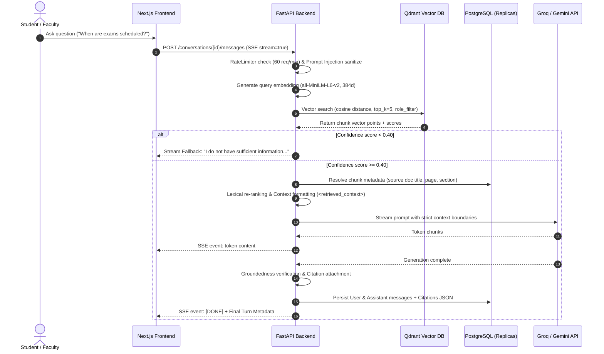
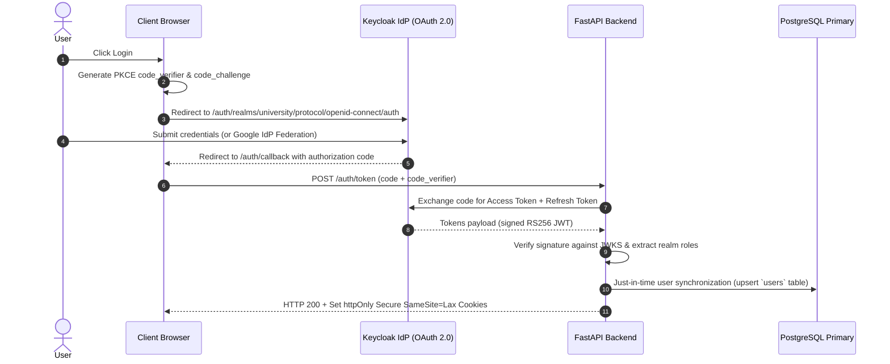
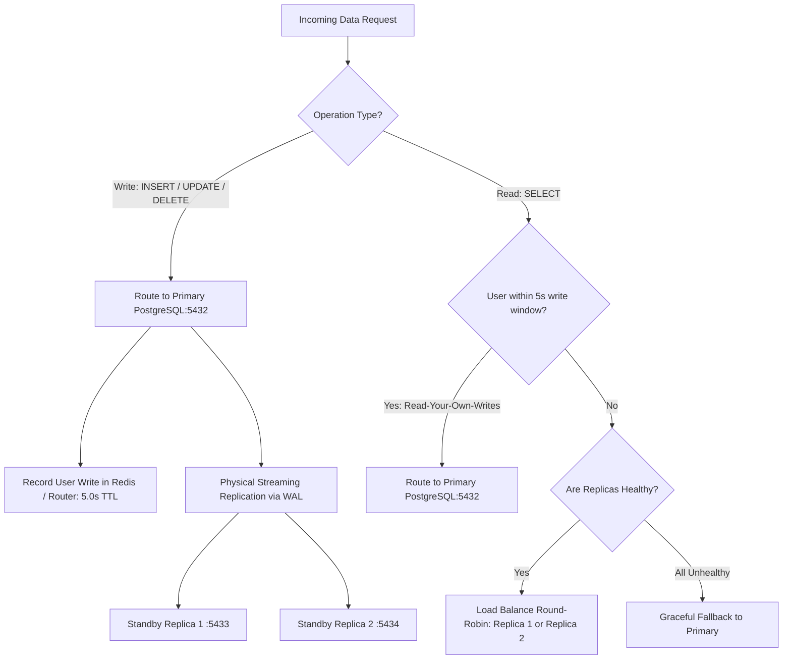

# System Architecture Specification

> **Project:** Generative AI-Based University Knowledge Assistant  
> **Capstone Project:** CS4191 Capstone Project II · B.Tech CSE (AI/ML)  
> **Student:** Aashu Kumar · **Roll No:** BT23GCS449  
> **Source-of-Truth Reference:** SDD v1.0, SRS v1.0, Master Project Guide  

---

## 1. Architectural Philosophy and Style

The system follows a **Modular Layered Architecture** with a **Single Backend Application Process** (FastAPI) and a modern **Frontend Single-Page Application** (Next.js 14 App Router).

```
+---------------------------------------------------------------------------------------------------+
|                                        CLIENT TIER                                                |
|                                                                                                   |
|   Browser (Student / Faculty / Admin) ───[ HTTPS / Browser Redirect ]───> Keycloak (OAuth/OIDC)  |
|                         │                                                                         |
|                         ▼                                                                         |
|   Frontend: Next.js 14 (React 18 + Tailwind CSS) [App Router, Server/Client Components, SSE]     |
+─────────────────────────┼─────────────────────────────────────────────────────────────────────────+
                          │ HTTPS REST + Server-Sent Events (`/conversations/{id}/messages`)
                          ▼
+───────────────────────────────────────────────────────────────────────────────────────────────────+
|                                 APPLICATION TIER (FastAPI Backend)                                 |
|                                                                                                   |
|  [ API Layer: FastAPIRouters (auth, conversations, chat, documents, admin, metrics, health) ]     |
|                                         │                                                         |
|  [ Middleware & Security Pipeline: JWTValidator, RBAC RoleGuard, RateLimiter, SecurityHeaders ]    |
|                                         │                                                         |
|  [ Business Service Layer ]             │                                                         |
|    ├── AuthService (C-AUTHSVC)          ├── DocumentService (C-DOCSVC)                            |
|    ├── ConversationService (C-CHATSVC)  ├── DocumentProcessingPipeline (C-PROC)                   |
|    ├── RAGService (C-RAGSVC)            ├── AdminService (C-ADMINSVC)                             |
|    ├── CitationResolver (C-CIT)         └── Advanced RAG (Re-ranking, Groundedness, Summarizer)   |
|                                         │                                                         |
|  [ Data Access Layer (C-DAL) ]          │                                                         |
|    ├── ReplicaRouter (Read-Your-Own-Writes Consistency Router)                                   |
|    ├── Repositories (UserRepository, DocumentRepository, ConversationRepository, AuditRepo)       |
|    └── Cache & Lock Client (Redis client for locks, session TTLs, and cache keys)                |
+───────┬─────────────────┬───────────────┬────────────────────────┬─────────────────────┬──────────+
        │ SQL (asyncpg)   │ gRPC / REST   │ S3 API                 │ Redis RESP          │ HTTPS    
        ▼                 ▼               ▼                        ▼                     ▼          
  PostgreSQL 16        Qdrant         MinIO S3                  Redis 7               LLM API       
 ├── Primary (RW)     Collection:    Bucket:                   - Locks (Redlock)     Groq (Llama 3) 
 ├── Replica 1 (RO)   `university_   `university-              - Query Cache         or Google      
 └── Replica 2 (RO)    documents`     documents`               - Sticky User Write   Gemini Flash   
```

---

## 2. Core Subsystems and Workflows

### 2.1 Retrieval-Augmented Generation (RAG) Workflow

The RAG pipeline implements context-grounded question answering with confidence-gated fallback and deterministic citation resolution:



### 2.2 OAuth 2.0 / OIDC Authentication Workflow

Authentication is powered by Keycloak using Authorization Code Flow with PKCE (Proof Key for Code Exchange) and role-based claim mapping:



### 2.3 Database Synchronization & Consistency Workflow

To combine high-throughput read scalability with strict read-after-write consistency, the backend employs a multi-node PostgreSQL topology managed by `ReplicaRouter`:



### 2.4 Optimistic Concurrency Control (Conflict Detection)

Concurrent administrative modifications to document metadata are protected by an integer `version` column:

1. **Read phase:** Client fetches document metadata containing `version: N`.
2. **Write attempt:** Client submits update with expected version:
   $$\text{UPDATE documents SET title = :new\_title, version = version + 1 WHERE id = :id AND version = :expected\_version}$$
3. **Outcome:**
   - If row is updated ($1$ row affected): Commit succeeds; version advances to $N + 1$.
   - If zero rows affected ($0$ rows affected): Another transaction already modified the document. The backend rolls back and raises `HTTP 409 Conflict` with error message *"Concurrent modification detected. The document was updated by another session."*

---

## 3. High-Availability Deployment Architecture

The production and evaluation deployment structure encompasses Docker Compose and Kubernetes declarative specifications:

```
                  ┌────────────────────────────────────────────────────────┐
                  │                 NGINX Ingress Controller               │
                  │   Path /        -> Service uka-frontend-service:3000   │
                  │   Path /api     -> Service uka-backend-service:8000    │
                  └───────────────────────────┬────────────────────────────┘
                                              │
                    ┌─────────────────────────┴─────────────────────────┐
                    ▼                                                   ▼
       ┌────────────────────────┐                          ┌────────────────────────┐
       │   Frontend Deployment  │                          │    Backend Deployment  │
       │   2 Replicas (Next.js) │                          │   2-5 Replicas (HPA)   │
       │   Resource Limits      │                          │   Autoscale on 70% CPU │
       └────────────────────────┘                          └───────────┬────────────┘
                                                                       │
           ┌──────────────────────┬──────────────────────┬─────────────┴────────┐
           ▼                      ▼                      ▼                      ▼
  ┌──────────────────┐  ┌──────────────────┐   ┌──────────────────┐   ┌──────────────────┐
  │ PostgreSQL (RW)  │  │ Qdrant Vector DB │   │ MinIO S3 Storage │   │ Redis 7 Cache    │
  │ Primary + 2 RO   │  │ PVC: 10Gi SSD    │   │ PVC: 20Gi SSD    │   │ Memory Store     │
  │ Streaming WAL    │  │ 384d Cosine Index│   │ Raw Document PDFs│   │ Distributed Lock │
  └──────────────────┘  └──────────────────┘   └──────────────────┘   └──────────────────┘
```
