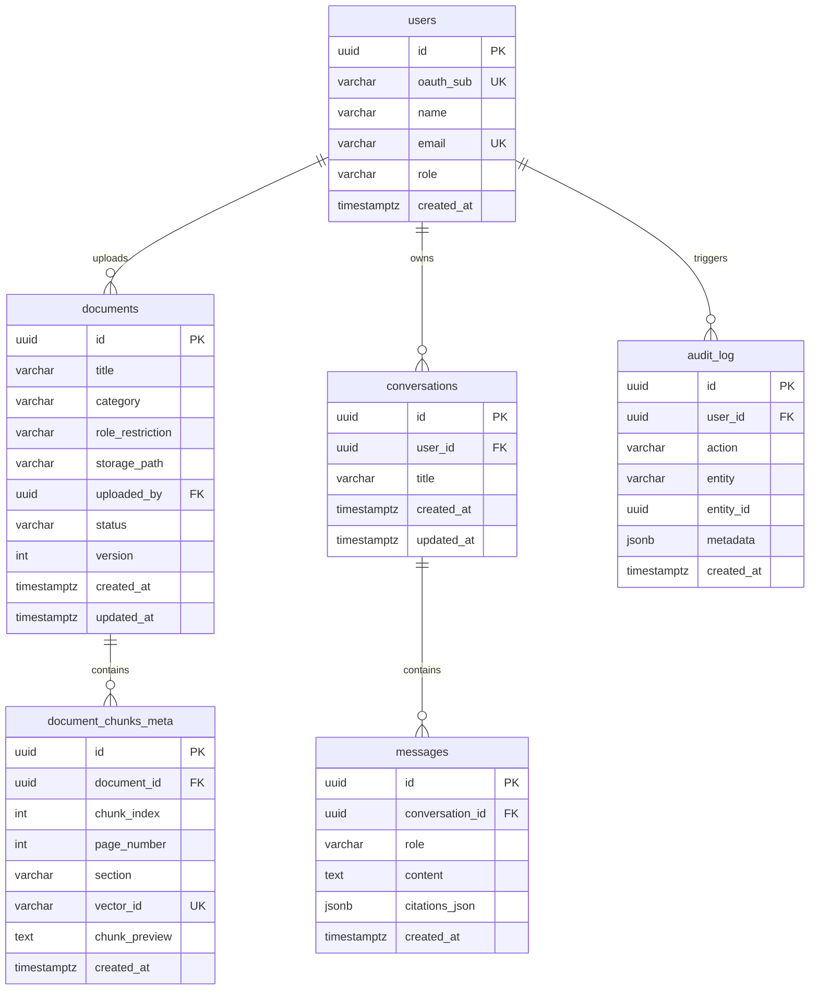

# Database Design and Data Persistence Architecture

> **Project:** Generative AI-Based University Knowledge Assistant  
> **Capstone Project:** CS4191 Capstone Project II · B.Tech CSE (AI/ML)  
> **Student:** Aashu Kumar · **Roll No:** BT23GCS449  
> **Source-of-Truth Reference:** SDD §4, SRS §2.3, Master Project Guide §8  

---

## 1. Relational Database Schema (PostgreSQL 16)

The primary relational data store runs on PostgreSQL 16, partitioned across a **Primary write node** and **two streaming read replicas**. Schemas are version-controlled and applied via **Alembic migrations**.



### Table Definitions & Constraints

#### 1. `users`
Tracks user identity records synchronized just-in-time from Keycloak tokens.
- `id` (UUID, Primary Key, `gen_random_uuid()`)
- `oauth_sub` (VARCHAR(255), Unique, Not Null): Subject identifier from Keycloak JWT.
- `name` (VARCHAR(255), Not Null): Full name of student/faculty/staff.
- `email` (VARCHAR(255), Unique, Not Null): University email address.
- `role` (VARCHAR(50), Not Null): Primary active role (`student`, `faculty`, `admin`).
- `created_at` (TIMESTAMPTZ, Default `NOW()`).

#### 2. `documents`
Catalog of ingested academic notices, handbooks, regulations, and circulars.
- `id` (UUID, Primary Key, `gen_random_uuid()`)
- `title` (VARCHAR(255), Not Null): Human-readable document title.
- `category` (VARCHAR(100), Not Null): Academic classification (e.g., `Academic`, `Examinations`, `Hostel`, `Fees`).
- `role_restriction` (VARCHAR(50), Not Null, Default `'student'`): Role required to view/search (`student`, `faculty`, `admin`).
- `storage_path` (VARCHAR(512), Not Null): Path to object inside MinIO bucket.
- `uploaded_by` (UUID, Foreign Key `users.id` ON DELETE SET NULL).
- `status` (VARCHAR(50), Not Null, Default `'uploaded'`): Lifecycle state (`uploaded`, `processing`, `ready`, `failed`).
- `version` (INTEGER, Not Null, Default 1): Incremental counter for optimistic locking.
- `created_at` (TIMESTAMPTZ, Default `NOW()`).
- `updated_at` (TIMESTAMPTZ, Default `NOW()`).

#### 3. `document_chunks_meta`
Granular metadata for extracted document chunks enabling deterministic citation mapping.
- `id` (UUID, Primary Key, `gen_random_uuid()`)
- `document_id` (UUID, Foreign Key `documents.id` ON DELETE CASCADE, Indexed).
- `chunk_index` (INTEGER, Not Null): Zero-indexed sequence within document.
- `page_number` (INTEGER, Not Null): 1-indexed source document page.
- `section` (VARCHAR(255), Nullable): Heading or policy section detected during extraction.
- `vector_id` (VARCHAR(255), Unique, Not Null): Corresponding point UUID in Qdrant collection.
- `chunk_preview` (TEXT, Nullable): Leading 200 characters for debug provenance.
- `created_at` (TIMESTAMPTZ, Default `NOW()`).

#### 4. `conversations`
User dialogue threads with multi-turn memory.
- `id` (UUID, Primary Key, `gen_random_uuid()`)
- `user_id` (UUID, Foreign Key `users.id` ON DELETE CASCADE, Indexed): Owner of conversation.
- `title` (VARCHAR(255), Not Null, Default `'New Conversation'`): Generated or user-assigned title.
- `created_at` (TIMESTAMPTZ, Default `NOW()`).
- `updated_at` (TIMESTAMPTZ, Default `NOW()`): Refreshed on every new turn.

#### 5. `messages`
Individual conversational turns in chronological sequence.
- `id` (UUID, Primary Key, `gen_random_uuid()`)
- `conversation_id` (UUID, Foreign Key `conversations.id` ON DELETE CASCADE, Indexed).
- `role` (VARCHAR(50), Not Null): Message emitter (`user`, `assistant`, `system`).
- `content` (TEXT, Not Null): Message body or streamed answer.
- `citations_json` (JSONB, Nullable): Serialized citations array (title, page, chunk_id).
- `created_at` (TIMESTAMPTZ, Default `NOW()`).

#### 6. `audit_log`
Immutable operational log of administrative and security events.
- `id` (UUID, Primary Key, `gen_random_uuid()`)
- `user_id` (UUID, Foreign Key `users.id` ON DELETE SET NULL).
- `action` (VARCHAR(100), Not Null): Event type (`UPLOAD`, `PROCESS`, `UPDATE_METADATA`, `DELETE`, `ROLE_CHANGE`).
- `entity` (VARCHAR(100), Not Null): Target entity (`document`, `user`, `system`).
- `entity_id` (UUID, Nullable): Target entity ID.
- `metadata` (JSONB, Nullable): Diagnostic delta or IP/agent details.
- `created_at` (TIMESTAMPTZ, Default `NOW()`).

---

## 2. Multi-Replica Physical Streaming Replication

To demonstrate database synchronization (Section 8 of Master Guide), PostgreSQL is deployed in a primary-standby topology:

```
[PostgreSQL Primary :5432] 
  ├── Write-Ahead Log (WAL) Level: replica
  ├── Replication Slots: replica_1_slot, replica_2_slot
  │
  ├── Physical Streaming (WAL Sender) ──────▶ [Standby Replica 1 :5433] (Hot Standby)
  └── Physical Streaming (WAL Sender) ──────▶ [Standby Replica 2 :5434] (Hot Standby)
```

### Replication Lag Telemetry
Standby replay lag is monitored live via the primary's `pg_stat_replication` catalog:
```sql
SELECT application_name,
       COALESCE(pg_wal_lsn_diff(pg_current_wal_lsn(), replay_lsn), 0) AS lag_bytes
FROM pg_stat_replication;
```
The sampled value is published directly to Prometheus as `uka_postgres_replication_lag_bytes{replica="replica_1"}`.

### Read-Your-Own-Writes Consistency
When a user executes a write operation (e.g. uploading a document or asking a question), `ReplicaRouter.record_user_write(user_id, window_seconds=5.0)` sets a short-lived sticky session flag. Subsequent read queries from that user during the 5.0-second window are routed directly to the Primary database, preventing stale reads caused by replication delay.

---

## 3. Vector Database Schema (Qdrant)

- **Collection Name:** `university_documents`
- **Vector Dimensions:** 384 dimensions (`sentence-transformers/all-MiniLM-L6-v2`)
- **Distance Metric:** Cosine
- **Payload Schema:**
  ```json
  {
    "document_id": "uuid-string",
    "chunk_id": "uuid-string",
    "chunk_index": 0,
    "page_number": 1,
    "title": "Examination Regulations 2026",
    "category": "Academic",
    "role_restriction": "student",
    "text": "Full text content of the chunk..."
  }
  ```
- **Payload Indexing:** Keyword indexes on `document_id`, `category`, and `role_restriction` enable instant filtered vector queries.

---

## 4. Object Storage & Caching Layer

1. **MinIO (S3 API):**
   - **Bucket:** `university-documents`
   - **Key Format:** `documents/{document_id}/{filename}`
   - Raw binary files are kept immutable. Deleting a document triggers cascading removal from MinIO.

2. **Redis 7 (In-Memory Data Structure):**
   - `ratelimit:{user_id}`: Sliding-window counter (TTL: 60s).
   - `write_window:{user_id}`: Primary stickiness flag (TTL: 5s).
   - `lock:doc:{document_id}`: Distributed lock for document processing.
